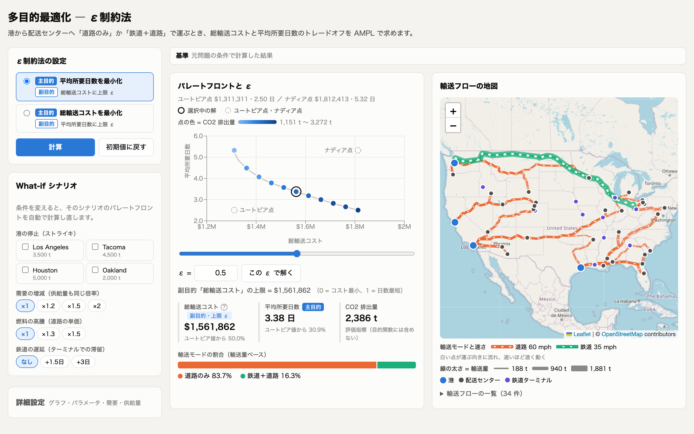
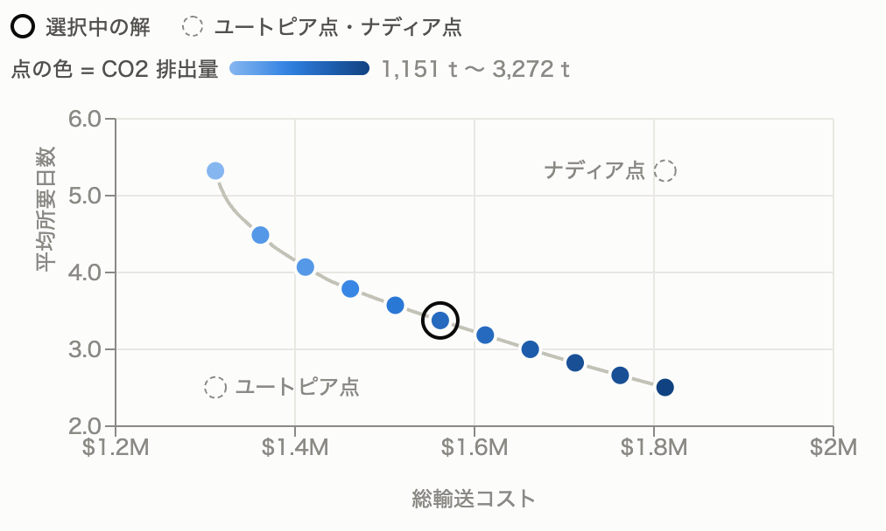
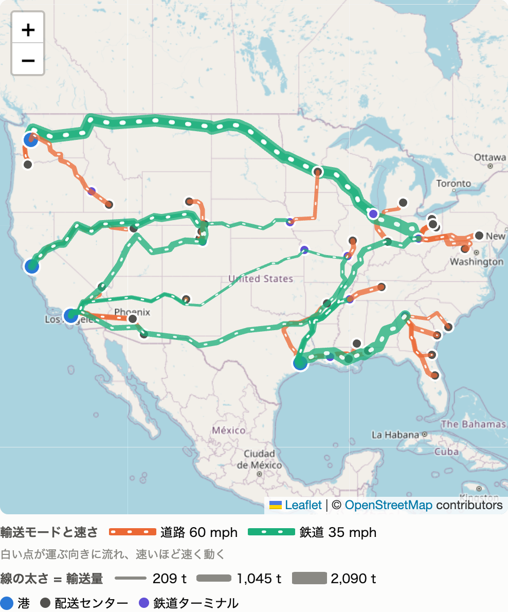
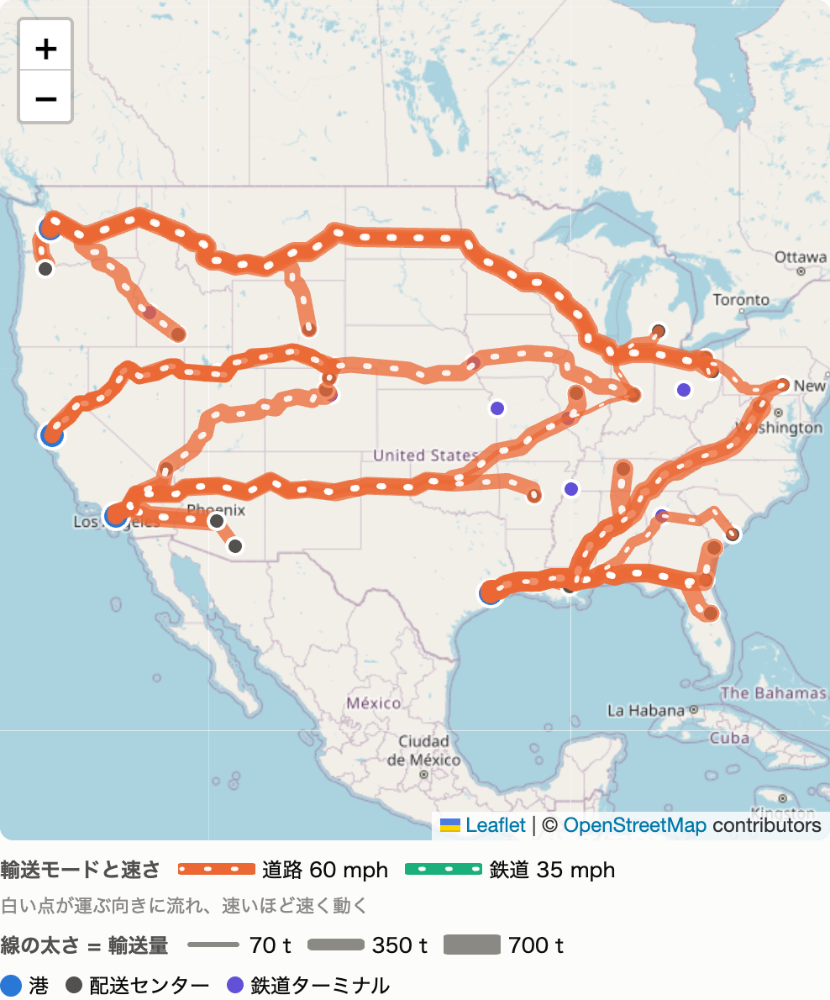

# 多目的最適化（ε制約法）Web アプリ ― スライド作成用まとめ

スライド担当の方向けに、アプリの機能、使い方、計算結果の読み方をまとめた資料です。
各章が、スライド 1〜2 枚分の内容になるように書いています。数値は、アプリを初期値のまま動かして得た実際の計算結果です。
図は `docs/images/` にあり、スライドに貼ってそのまま使えます（高解像度で保存しています）。

- 問題設定（データ・数式）の詳細: [problem.md](problem.md)
- アプリの起動方法・他の PC での準備: [optimization/multiobjective_app/README.md](../optimization/multiobjective_app/README.md)

---

## 1. このアプリで何がわかるか（導入スライド向け）

**伝えたいこと**: 「安く運ぶ」と「早く運ぶ」は両立しない。どこで折り合いをつけるかを、数字と地図で比べられるようにしたのがこのアプリ。

- 米国の 4 つの港（Los Angeles・Tacoma・Houston・Oakland）から、30 か所の配送センターへ合計 15,000 トンを運ぶ。
- 運び方は 2 通り。
  - **道路のみ**: 速いが高く、CO2 も多い。
  - **鉄道＋道路**: 港から鉄道で配送センター近くのターミナルまで運び、そこからトラックで届ける。安くて CO2 も少ないが遅い（ターミナルで 1.5 日待つ）。
- 「総輸送コスト」と「平均所要日数」の 2 つを同時に小さくしたいが、片方を良くするともう片方が悪くなる。この関係（**トレードオフ**）を **ε制約法** で求め、グラフと地図で見せる。
- 元になった教材: MIT SCM.275x「Multi-Objective Optimization - Epsilon Constraint Method」の演習。最適化には AMPL（ソルバーは HiGHS）を使っている。

**使う図**: `images/app_overview.png`（アプリ全体の画面）

---

## 2. アプリの機能



| 画面の部分 | できること |
|---|---|
| 左: **ε制約法の設定** | 主目的・副目的（どちらを最小化し、どちらに上限 ε をかけるか）の切り替え、「計算」「初期値に戻す」ボタン |
| 左: **What-if シナリオ** | 港の停止（他港へ振り替え）・需要の増減（供給量も同じ倍率）・燃料の高騰（道路の単価）・鉄道の遅延（ターミナルでの滞留）をボタンで切り替える |
| 左: **詳細設定**（最初は閉じている） | グラフの点の数（5〜21）、コスト（単価・最低料金）、所要時間（速度・稼働時間・滞留日数）、CO2 排出係数、港の供給量・配送センターの需要 |
| 中央: **パレートフロントと ε** | 見出しの下にユートピア点・ナディア点。総輸送コスト（横軸）と平均所要日数（縦軸）のトレードオフ曲線（点の色は CO2）。スライダーで ε を動かすと、その解の総輸送コスト・平均所要日数・CO2・輸送モードの割合がすぐに切り替わる |
| 右: **輸送フローの地図** | 選んだ解の経路（オレンジ = 道路、緑 = 鉄道、線の太さ = 輸送量）。白い点が運ぶ向きに流れ、速さは平均速度に比例する。一覧表も開ける |

**補足（質問が出たとき用）**

- 入力欄に空欄や範囲外の値があると、その欄が赤くなり、理由が日本語で表示される。計算は行わない。
- 入力やシナリオを変えると、0.6 秒後に自動で計算し直す。計算中は結果の上に「計算中」と重ねて表示する（画面はずれない）。
- 総輸送コストは運賃の合計（積み替え・保管・在庫の費用や時間価値は含まない）。画面の「?」にマウスを乗せると定義が出る。
- 道路網・鉄道網上の距離は、事前に一度だけ計算して保存してある（毎回の計算は速い）。

---

## 3. 使い方（操作手順スライド向け）

1. **アプリを開く**: 起動するとすぐに、初期値で計算が始まる（Mac で1秒以内、作成した Windows PC で 10〜20 秒ほど）。
2. **主目的を選ぶ**: 「所要日数を最小化（総輸送コストに上限 ε）」か「総輸送コストを最小化（平均所要日数に上限 ε）」。初期値は前者。
3. **必要なら What-if シナリオやパラメータを変える**（自動で計算し直す）: たとえば港を止めたり、鉄道の遅延を加えたりして、曲線がどう動くかを比べられる。
4. **パレートフロントを見る**: 曲線の点にマウスを乗せると値が出る。クリックするとその解が選ばれる。
5. **スライダーで ε を動かす**: 0.01 刻みで、結果と地図がその場で切り替わる。0.333 のような半端な値は、数値欄に入れて「この ε で解く」を押す（Mac では一瞬）。
6. **地図と一覧で中身を確かめる**: どの港からどの配送センターへ、道路と鉄道のどちらで運ぶか。


---

## 4. ε制約法のしくみ（考え方スライド向け）

**伝えたいこと**: 2 つの目的を 1 つずつに分け、「片方を最小化、もう片方は上限つきの制約」にして、上限を少しずつ動かしながら何度も解く。

初期設定（主目的 = 所要日数）では、次の問題を解く。

```
最小化する:  平均所要日数
条件:        総輸送コスト ≤ 上限（ε で決まる）
             各配送センターの需要を満たす
             各港の供給量を超えない
```

- 上限は ε（0〜1）で決める。ε = 0 のとき上限はコストの最小値、ε = 1 のとき上限はコストの最大値（実質的に制限なし）。
  - 上限 = ユートピアコスト ＋ ε ×（ナディアコスト − ユートピアコスト）
- ε を 0 から 1 まで動かして解いた点を結ぶと、**パレートフロント**（どちらかを悪くしないと、もう片方を良くできない解の集まり）になる。
- 主目的を「総輸送コスト」に切り替えても、**同じ曲線** が得られる（確認済み）。ただし、同じ ε でも曲線上の **別の点** を指す（例: ε = 0.5 は、主目的が所要日数なら $1,561,862・3.38 日、主目的が総輸送コストなら $1,435,456・3.91 日）。スライドで ε の値を示すときは、どちらの主目的かを併記すること。

---

## 5. 結果のまとめ: ユートピア点とナディア点


| | 総輸送コスト | 平均所要日数 |
|---|---:|---:|
| **ユートピア点**（それぞれの最良値） | $1,311,311 | 2.50 日 |
| **ナディア点**（パレートフロント上での最悪値） | $1,812,413 | 5.32 日 |
| 差 | +$501,102（+38.2%） | 2.82 日（−53%） |

**読み方**

- **ユートピア点** = 「コストも日数も、それぞれの最良値」を組み合わせた理想の点。**実際には実現できない**（コスト最小の解は 5.32 日かかり、日数最短の解は $1,812,413 かかる）。
- **ナディア点** = パレートフロント上の解の中で、それぞれの目的が最も悪くなる値。コストのナディア値は「日数を最短にしたときのコスト」、日数のナディア値は「コストを最小にしたときの日数」。
- この 2 点の間が、パレートフロントが通る範囲になる。ε の正規化（0〜1）にもこの範囲を使う。
- 一言でいうと: **「日数を半分（5.32 → 2.50 日）にするには、コストが約 4 割（+$50 万）増える」**。

---

## 6. 結果のまとめ: トレードオフの読み方



主目的 = 所要日数、点の数 = 11（ε を 0.1 刻み）の結果:

| ε | 総輸送コスト | 平均所要日数 | CO2 排出量 | 道路のみ | 鉄道＋道路 |
|---:|---:|---:|---:|---:|---:|
| 0.0 | $1,311,312 | 5.32 日 | 1,151 t | 34.1% | 65.9% |
| 0.1 | $1,361,422 | 4.49 日 | 1,556 t | 55.5% | 44.5% |
| 0.2 | $1,411,532 | 4.07 日 | 1,804 t | 67.4% | 32.6% |
| 0.3 | $1,461,642 | 3.79 日 | 2,001 t | 75.7% | 24.3% |
| 0.4 | $1,511,752 | 3.57 日 | 2,197 t | 80.0% | 20.0% |
| 0.5 | $1,561,862 | 3.38 日 | 2,386 t | 83.7% | 16.3% |
| 0.6 | $1,611,973 | 3.19 日 | 2,575 t | 87.1% | 12.9% |
| 0.7 | $1,662,083 | 3.00 日 | 2,763 t | 90.5% | 9.5% |
| 0.8 | $1,712,193 | 2.82 日 | 2,940 t | 94.0% | 6.0% |
| 0.9 | $1,762,303 | 2.66 日 | 3,107 t | 97.1% | 2.9% |
| 1.0 | $1,812,413 | 2.50 日 | 3,272 t | 100.0% | 0.0% |

### 読み方のポイント（スライドの主張に使える 4 点）

1. **曲線は右下がり**: 左上（安いが遅い）から右下（速いが高い）へ。曲線上のどの点も「最適」で、どれを選ぶかは方針しだい。曲線より左下の点は実現できず、右上の点はムダがある。
2. **最初の追加予算ほど効く（収穫逓減）**: ε を 0.1 増やすごとにコストは同じ +$50,110 ずつ増えるが、短縮できる日数はどんどん減る。
   - 最初の +$50,110（+3.8%）で **0.84 日** 短縮（短縮できる幅 2.82 日の約 30%）
   - ε = 0.2 まで（+$100,220、+7.6%）で **1.25 日** 短縮（約 44%）
   - 最後の +$50,110（ε 0.9 → 1.0）では **0.16 日** しか短縮できない
   - 1 日短縮するのにかかる費用は、約 **$6 万/日**（ε 0 → 0.1）から約 **$32 万/日**（ε 0.9 → 1.0）へと **5 倍以上** に上がる。
   - → グラフの左側（ε = 0.1〜0.3 あたり）で曲線が急に曲がっている。ここが「少しの追加コストで大きく早くなる」、費用対効果の良い領域。
3. **早くするほど CO2 が増える**: 日数を縮めるほど鉄道の割合が減り（65.9% → 0%）、CO2 は 1,151 t から 3,272 t へ **約 2.8 倍** になる。コストと日数のほかに環境面の代償もあることを、点の色（濃いほど CO2 が多い）で示している。
4. **鉄道が最後まで残るのは Tacoma 発**: ε = 0.5 では、鉄道を使うのは Tacoma 港からの 2,451 t だけで、残りの港はすべて道路のみ。ε = 0（コスト最小）では 4 港すべてで鉄道を多く使っている。

### 地図で見る両端の違い

| ε = 0（コスト最小、5.32 日） | ε = 1（日数最短、2.50 日） |
|---|---|
|  |  |
| 緑（鉄道）が多い。鉄道 65.9%、CO2 1,151 t | すべてオレンジ（道路）。鉄道 0%、CO2 3,272 t |

ε = 0, 0.5, 1 の結果パネル（数値と輸送モードの割合）: `images/epsilon_result_0.png`、`images/epsilon_result_0.5.png`、`images/epsilon_result_1.png`

---

## 7. スライドに載せるときの注意（前提と限界）

- **単位**: コストはドル（ノートブックのトン・マイル単価による）。平均所要日数は「1 日 8 時間稼働」として計算した日数を、輸送量で加重平均したもの。CO2 はトン。
- **パラメータの出典**: 単価・速度などはノートブックの値。CO2 排出係数は米議会予算局（CBO）の資料（道路 0.4、鉄道 0.05 ポンド/トン・マイル）。
- **モデルの簡略化**: 各配送センターが使う鉄道ターミナルは、直線距離で最も近い 1 か所に固定。輸送量は連続量（端数あり）として扱っている。港は元データの先頭 4 港だけを使う。
- **CO2 は目的関数に入れていない**: 最小化しているのはコストと日数だけ。CO2 は結果として表示しているだけなので、「CO2 も最適化した」とは書かないこと。
- **計算時間**: 作成した PC（Windows）では 1 回の計算に 12〜17 秒かかる（大半はソルバーを起動する時間）。Mac では約 0.2 秒。発表はこの Mac で行う。

---

## 8. 用語集（スライドの脚注向け）

| 用語 | 意味 |
|---|---|
| 多目的最適化 | 複数の目的（ここではコストと日数）を同時に扱う最適化 |
| ε制約法 | 1 つの目的だけを最小化し、残りの目的は「上限 ε 以下」という制約にして解く方法。ε を動かしながら繰り返し解く |
| パレート最適解 | どれか 1 つの目的を悪くしないと、他の目的を良くできない解 |
| パレートフロント | パレート最適解を目的の値でグラフにしたもの（トレードオフ曲線） |
| ユートピア点 | 各目的の最良値を組み合わせた点。通常は実現できない |
| ナディア点 | パレート最適解の中で、各目的が最も悪くなる値を組み合わせた点 |
| 主目的 / 副目的 | ε制約法で最小化する目的 / 上限 ε をかける目的 |
| 収穫逓減 | 同じ量を追加しても、得られる効果がだんだん小さくなること |
